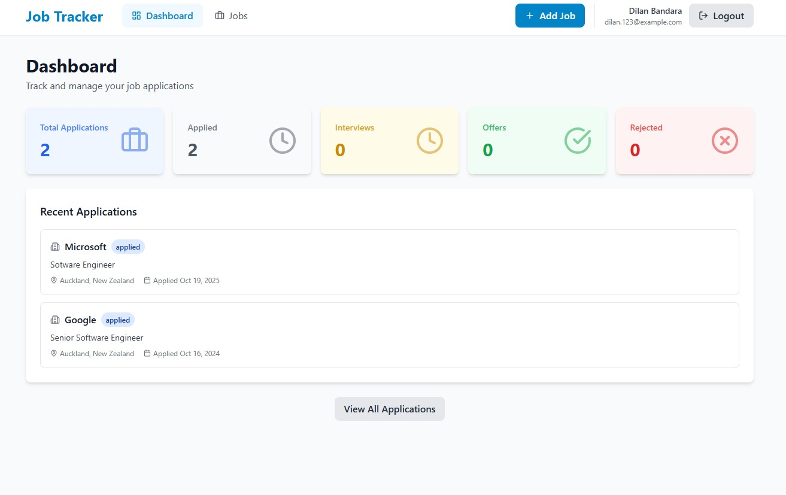
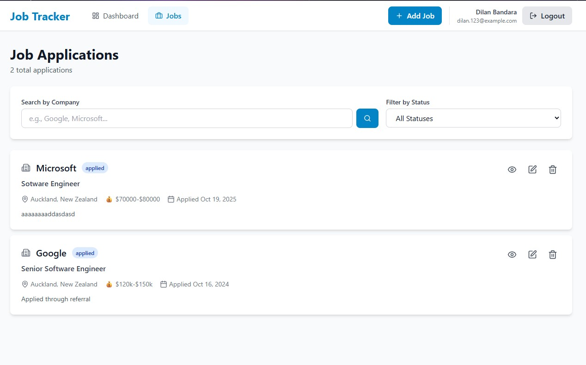
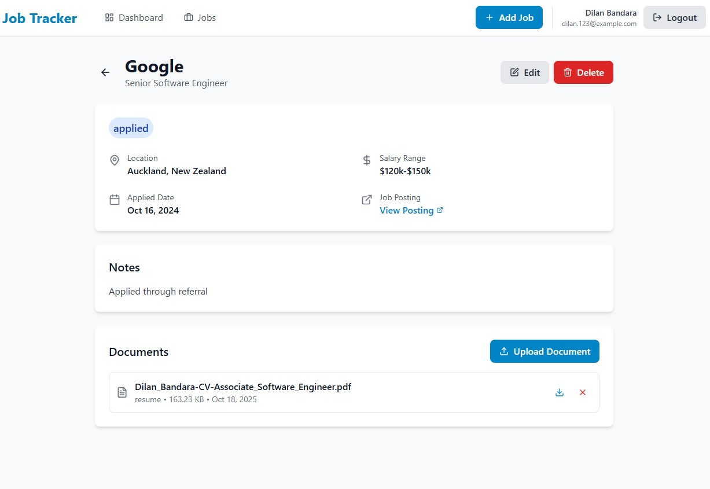
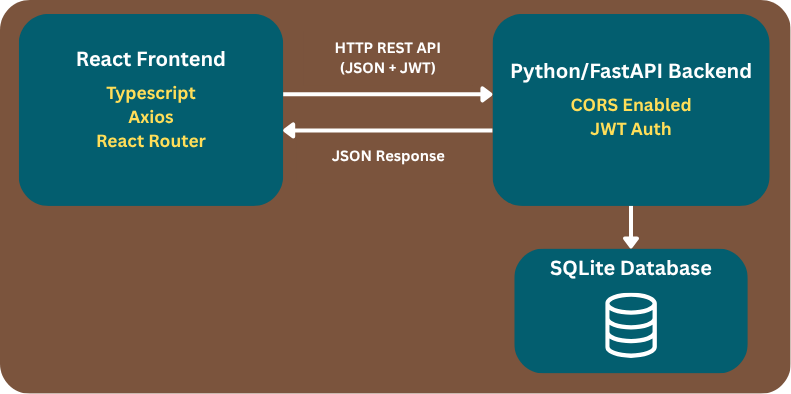

# 📋 Job Application Tracker

### A full-stack web application designed to help job seekers manage and track their job applications efficiently. This project was built as a learning initiative to master Python and FastAPI with the help of web, while transitioning from Java/Spring Boot development, demonstrating practical application of modern web development technologies and best practices.

## 📸 Screenshots

### Dashboard


### Job Applications List


### Job Details with File Upload


## ✨ Features

### Core Functionality
- ✅ **User Authentication** - Secure JWT-based authentication system
- ✅ **Job Application Management** - Complete CRUD operations
- ✅ **File Upload/Download** - Upload resumes and cover letters with secure storage
- ✅ **Dashboard Analytics** - Real-time statistics and insights
- ✅ **Advanced Filtering** - Search by company, filter by status
- ✅ **Pagination** - Efficient data loading for large datasets

### Technical Features
- ✅ RESTful API design with OpenAPI documentation
- ✅ Responsive design for mobile and desktop
- ✅ Protected routes and role-based access
- ✅ Form validation with detailed error messages
- ✅ Optimistic UI updates for better UX
- ✅ Docker containerization for easy deployment

## 🏗️ System Architecture

### High-Level Architecture



### Architecture Pattern: Layered Architecture

**Frontend (Presentation Layer)**
- React components for UI rendering
- Axios for HTTP API communication
- React Context API for global state management
- Protected routes with JWT authentication

**Backend (Application Layer)**
- **API Layer (Controllers):** Handle HTTP requests, validate input, return responses
- **Service Layer:** Business logic, authentication, file handling, data transformation
- **Repository Layer:** Database operations, queries, data persistence
- **Database Layer:** SQLite with SQLAlchemy ORM for data modeling

### Key Features
- **Direct API Communication:** Frontend calls backend REST APIs directly (no API Gateway)
- **Stateless Authentication:** JWT tokens for secure, scalable authentication
- **RESTful Design:** Standard HTTP methods (GET, POST, PUT, DELETE)
- **File Storage:** Local filesystem for uploaded documents
- **CORS Enabled:** Configured for cross-origin requests from frontend
- **Type Safety:** TypeScript on frontend, Pydantic validation on backend

## 🛠️ Tech Stack

### Backend
| Technology | Purpose |
|------------|---------|
| **FastAPI** | Modern Python web framework for building APIs |
| **SQLAlchemy** | SQL toolkit and ORM for database operations |
| **Pydantic** | Data validation using Python type hints |
| **Python-Jose** | JWT token generation and validation |
| **Passlib** | Password hashing with bcrypt |
| **Uvicorn** | ASGI server for running FastAPI |
| **SQLite** | Lightweight database (easily switchable to PostgreSQL) |

### Frontend
| Technology | Purpose |
|------------|---------|
| **React 18** | UI library for building interactive interfaces |
| **TypeScript** | Type-safe JavaScript for better development |
| **Vite** | Fast build tool and dev server |
| **React Router** | Client-side routing |
| **Axios** | HTTP client for API communication |
| **React Hook Form** | Efficient form handling and validation |
| **Tailwind CSS** | Utility-first CSS framework |
| **Lucide React** | Beautiful icon library |
| **date-fns** | Modern date utility library |

### DevOps
| Technology | Purpose |
|------------|---------|
| **Docker** | Containerization for consistent environments |
| **Docker Compose** | Multi-container orchestration |
| **Nginx** | Web server for serving frontend |

## 📦 Installation & Setup

### Prerequisites
- Python 3.10+
- Node.js 18+
- Docker & Docker Compose (optional)

### Method 1: Docker (Recommended)

```bash
# Clone the repository
git clone https://github.com/diliboy/Job-Tracker-Python_and_React.git
cd job-tracker

# Build and run with Docker Compose
docker-compose up --build

# Access the application
# Frontend: http://localhost
# Backend: http://localhost:8000
# API Docs: http://localhost:8000/api/docs
```

### Method 2: Manual Setup

#### Backend Setup

```bash
cd backend

# Create virtual environment
python -m venv venv

# Activate virtual environment
# Windows:
venv\Scripts\activate
# Mac/Linux:
source venv/bin/activate

# Install dependencies
pip install -r requirements.txt

# Create .env file
cp .env.example .env
# Edit .env with your configuration

# Run the application
uvicorn app.main:app --reload
```

#### Frontend Setup

```bash
cd frontend

# Install dependencies
npm install

# Create environment file
cp .env.example .env
# Edit .env if needed

# Run development server
npm run dev
```

## 🔐 Environment Variables

### Backend (.env)

```env
# Application
APP_NAME="Job Tracker API"
DEBUG=False
ENVIRONMENT=production

# Database
DATABASE_URL=sqlite:///./job_tracker.db

# Security
SECRET_KEY=your-super-secret-key-min-32-characters
ALGORITHM=HS256
ACCESS_TOKEN_EXPIRE_MINUTES=30

# CORS
ALLOWED_ORIGINS=http://localhost:3000,https://your-frontend-domain.com

# File Upload
UPLOAD_DIR=./uploads
MAX_UPLOAD_SIZE=5242880  # 5MB
```

### Frontend (.env)

```env
VITE_API_URL=http://localhost:8000/api/v1
```

## 🧪 API Documentation

The API documentation is automatically generated using FastAPI's built-in Swagger UI.

**Local:** http://localhost:8000/api/docs

## 🧪 Testing

```bash
# Backend tests (pytest + httpx.AsyncClient against an isolated SQLite DB)
cd backend
pip install -r requirements.txt
pytest -v

# Frontend tests (Vitest + React Testing Library)
cd frontend
npm install
npm test
```

The backend suite covers the full register → login → `/auth/me` flow (success
paths, duplicate email, wrong password, missing/invalid token). The frontend
suite currently covers the `StatsCard` component; the same `render()` +
`@testing-library/react` pattern in `src/components/StatsCard.test.tsx` is a
template for testing the rest of the components and pages.

## 🚀 Deployment

This project deploys as two independent services: the **backend** (FastAPI)
on **Render**, and the **frontend** (static Vite build) on **Vercel**.

### Backend → Render

1. Push this repo to GitHub.
2. In Render, choose **New + → Blueprint** and point it at the repo — it will
   pick up `render.yaml` at the project root and configure the service from
   `backend/Dockerfile` automatically. (Alternatively, create a **Web
   Service** manually, set the environment to **Docker**, and set the root
   directory to `backend`.)
3. Render auto-generates `SECRET_KEY` and injects `PORT`; the Dockerfile's
   `CMD` already binds to `$PORT`. Fill in the remaining vars from
   `backend/.env.example` in the Render dashboard.
4. **Database note:** the default `DATABASE_URL` in `render.yaml` is SQLite,
   which lives on Render's ephemeral filesystem — it's fine for a first
   deploy/demo, but the file is wiped on every redeploy or restart. For
   anything you want to persist, either attach a
   [Render Disk](https://render.com/docs/disks) and point `DATABASE_URL` at a
   file inside it, or provision a Render PostgreSQL instance and paste its
   connection string in as `DATABASE_URL` (see `backend/.env.example` for the
   exact format — `postgresql://`, not `postgres://`).
5. Once deployed, note your backend's `https://<service>.onrender.com` URL.

### Frontend → Vercel

1. In Vercel, import the same GitHub repo and set the project's **root
   directory** to `frontend`.
2. Vercel auto-detects the Vite framework preset (build command
   `npm run build`, output directory `dist`).
3. Add an environment variable `VITE_API_URL` set to
   `https://<your-render-service>.onrender.com/api/v1` — or just edit
   `frontend/.env.production`, which already has a placeholder for this and
   is picked up automatically by `vite build`.
4. `frontend/vercel.json` is already included and rewrites all routes to
   `index.html`, which React Router needs to handle deep links (e.g.
   refreshing `/jobs/12`) without a 404.
5. After the first deploy, go back to the Render dashboard and update
   `ALLOWED_ORIGINS` to include your real `https://your-app.vercel.app` URL
   (CORS will otherwise block the deployed frontend from calling the API).

## 📝 Future Enhancements

### Planned Features
- [ ] Email notifications for follow-up reminders
- [ ] Export applications to CSV/Excel
- [ ] Mobile app (React Native)

## 📄 License

This project is licensed under the [MIT License](LICENSE).

## 👤 Author

**Dilan Bandara**

- Portfolio: [portfolio.com](https://dilanbandara.vercel.app/)
- LinkedIn: [linkedin.com/in/profile](https://www.linkedin.com/in/dilanbandara/)
- GitHub: [@diliboy](https://github.com/diliboy)

⭐ **If you find this project helpful, please give it a star!** ⭐
